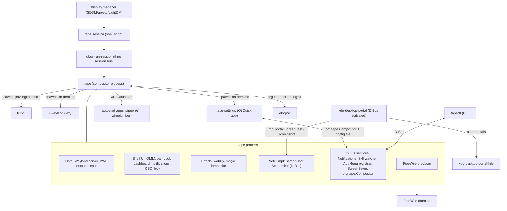
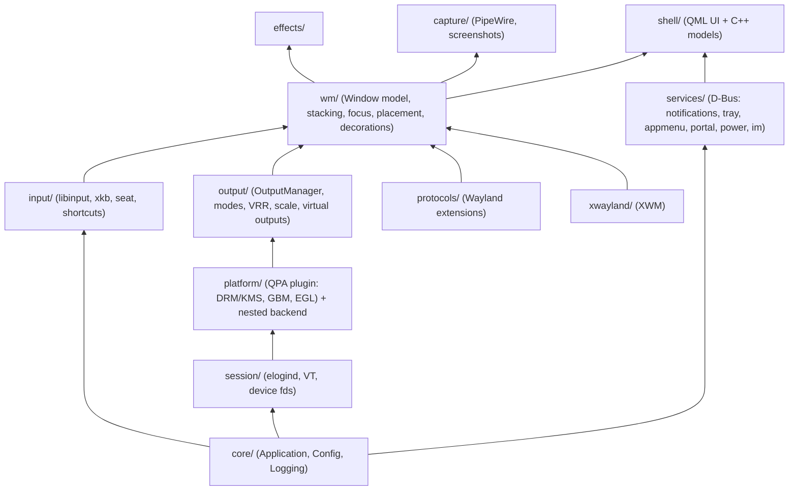
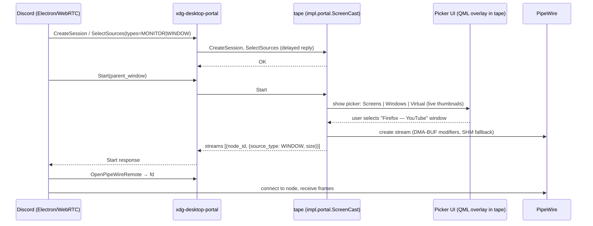
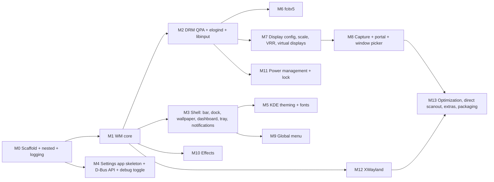

# Tape Compositor — Stacking Wayland Compositor: Master Plan

> **Status:** Planning phase. This document is the **source of truth** for all future code generation.
> Any code produced for this project must follow the architecture, conventions and milestone order defined here.
> Progress is tracked in [CHECKLIST.md](CHECKLIST.md) (IDs like `M2.4` refer to checklist items).
> All requirements and dependencies (with IDs `R*`, `I*`, `N*`, `D*`) are listed in [REQUIREMENTS.md](REQUIREMENTS.md).
>
> **Code generation guide — read before generating any code:**
> 1. Check [REQUIREMENTS.md](REQUIREMENTS.md): the change must satisfy the relevant requirement(s) and use only the listed dependencies/versions (**Qt 6.12**).
> 2. Follow the architecture in this file (module layering §3.2, directory layout §5, conventions §22).
> 3. Pick the next unchecked item(s) in [CHECKLIST.md](CHECKLIST.md) in milestone order, and tick them when done.
> 4. If a requirement, dependency or design decision changes, update REQUIREMENTS.md / PLAN.md **first** (with date + reason).
>
> **Project name:** **Tape Compositor** (binary `tape`, C++ namespace `Tape`, folder `tape-compositor/`).

---

## 1. Goals & Non-Goals

### 1.1 Goals (requirements)

| # | Requirement | Section |
|---|-------------|---------|
| R1 | xdg-desktop-portal backend (ScreenCast/Screenshot) with **per-window selection** (e.g. Discord streaming) | §9 |
| R2 | Built on **QtWayland Compositor** (Qt 6.12), themed with **KDE themes** (color schemes, icons, cursors, fonts, decorations) | §4, §11 |
| R3 | Desktop effects: **wobbly windows, magic lamp, blur** (+ fade/scale basics) | §12 |
| R4 | **Minimal resource usage** (measurable budgets) | §17 |
| R5 | **Debug log toggle** at runtime | §16 |
| R6 | **Settings app** (pages start as placeholders, filled per milestone) | §15 |
| R7 | **App dashboard** (Launchpad-style launcher) | §13.3 |
| R8 | **Global menu** | §13.5 |
| R9 | **elogind** as session manager (systemd-logind optional later) | §6 |
| R10 | **Built-in fcitx5** + fcitx5 settings page | §10 |
| R11 | Display configuration: resolution, refresh rate, position, transform | §8 |
| R12 | **Virtual displays** | §8.5 |
| R13 | **Adaptive Sync (VRR)** | §8.4 |
| R14 | **Scaling** (integer + fractional) | §8.3 |
| R15 | **Wallpaper** | §13.2 |
| R16 | **Text & Fonts** settings | §11.4 |
| R17 | **Notifications** | §13.6 |
| R18 | **Power management** config (dim, screen off, sleep timers) | §14 |
| R19 | **Top-bar + bottom-dock + dashboard shell layout** (inspired by global-menu/dock workflows, styled with **KDE Breeze** as default theme — no 1:1 macOS visual copy or macOS window theme) | §13 |

### 1.2 Implied requirements (needed for a usable desktop)
- XWayland support (Steam, games, older Electron apps, X11-only tools) — §7.6
- Server-side decorations, top bar, dock/taskbar (magic lamp needs a minimize target) — §13
- System tray (StatusNotifierItem) — fcitx5 and Discord use it — §13.4
- Lock screen (needed for "lock on sleep") — §14.4
- XDG autostart (no systemd user session to do it for us) — §6.3

### 1.3 Non-goals (for v1)
- Tiling layouts (only edge snapping / quarter tiling)
- HDR / color management (keep an eye on `wp_color_management_v1` for v2)
- Vulkan renderer (Qt RHI on OpenGL ES / GL only)
- Touch gestures beyond basic touchpad swipe (v2)
- Running on non-Linux kernels

---

## 2. Technology Stack

| Area | Choice | Notes |
|------|--------|-------|
| Language | **C++20** + **QML** | No JS business logic in QML beyond bindings/glue |
| Toolkit | **Qt 6.12** (pinned): Core, Gui, Quick, WaylandCompositor, DBus, ShaderTools, Concurrent, Svg | Private headers used (`Qt6::GuiPrivate`, `Qt6::WaylandCompositorPrivate`) → **exactly 6.12.x**; use Qt 6.12 APIs freely, no compatibility code for older Qt. Check built-in compositor extensions against the Qt 6.12 docs |
| KDE | **KF6**: Config, ColorScheme, GuiAddons, IconThemes, Service, I18n; optional **KDecoration3** | For theming & reading `kdeglobals` |
| Build | **CMake ≥ 3.24** + Ninja, `qt_add_qml_module`, `qt_add_shaders`, `qt6_generate_wayland_protocol_server_sources` | |
| Graphics | **libdrm** (atomic KMS), **GBM**, **EGL/GLESv2** | |
| Input | **libinput**, **libudev** (eudev or systemd-udev), **xkbcommon** | |
| Session | **elogind** via D-Bus `org.freedesktop.login1` (same API as systemd-logind) | No libsystemd/libelogind link required |
| Screen capture | **PipeWire ≥ 0.3.60** (DMA-BUF + SHM fallback) | |
| Portal | **xdg-desktop-portal ≥ 1.18** frontend; our impl for ScreenCast/Screenshot; **xdg-desktop-portal-kde** for the rest | |
| Input method | **fcitx5** (waylandim addon) | |
| X11 compat | **Xwayland ≥ 23.1** + **xcb** (xcb, xcb-composite, xcb-xfixes, xcb-res, xcb-icccm, xcb-ewmh) | |
| Power | elogind, **UPower** (battery/AC), optional power-profiles-daemon | |
| Auth (lock) | **PAM** | |
| Protocol XML | wayland-protocols ≥ 1.38, plasma-wayland-protocols, wlr-protocols (vendored copies in `protocols/`) | |

---

## 3. High-Level Architecture

### 3.1 Process model (minimal processes)

The compositor is a **single process** that hosts the Wayland server, window manager, shell UI (bar, dock, dashboard, notifications, OSD, lock screen), effects, the portal backend and D-Bus services. Only heavy-but-rarely-used UI runs out of process.



`*` pipewire/wireplumber are only spawned if not already running and `[Session] StartPipeWire=true`.

### 3.2 Internal module layering



Rule: **lower layers never include headers from higher layers.** Communication upward is via Qt signals or interfaces.

---

## 4. Rendering & Platform Backend

### 4.1 Problem
QtWayland Compositor renders through Qt's QPA. The stock `eglfs_kms` QPA only reads output config at startup (`QT_QPA_EGLFS_KMS_CONFIG`), cannot change modes at runtime, has no VRR control, no hardware cursor control we can drive, and opens DRM devices itself (no elogind `TakeDevice`). R11/R13/R9 therefore require our own platform layer.

### 4.2 Decision: in-tree QPA plugin `tape-drm`
- A minimal QPA plugin derived from the design of Qt's `eglfs` + `eglfs_kms_gbm` (GPL-3 compatible), built in-tree and loaded with `-platform tape-drm` (or `QT_QPA_PLATFORM`).
- Responsibilities:
  - Open DRM/input devices **through the session layer** (elogind `TakeDevice` fd passing) — never `open()` directly.
  - One `QPlatformScreen` per connected connector; one `QPlatformWindow` (GBM surface + EGL window surface) per output.
  - **Atomic KMS** commits; page-flip event driven; `DRM_MODE_ATOMIC_TEST_ONLY` for config validation.
  - Runtime mode set, VRR (`VRR_ENABLED`), DPMS (`ACTIVE`), gamma/CTM (future night light), hardware cursor plane.
  - Hotplug via udev monitor → add/remove screens (`QWindowSystemInterface::handleScreenAdded/Removed`).
  - Device pause/resume (VT switch) → drop DRM master / restore state.
  - Exposes a native interface (`TapePlatformInterface`) to the compositor core: `modes()`, `applyConfig(OutputConfig, testOnly)`, `setVrr()`, `setDpms()`, `setCursor()`, `scanoutCandidate()` (future direct scanout).
- **libinput is NOT handled by the QPA**; input lives in `input/` (core), so the QPA stays display-only. (QPA's built-in evdev/libinput handlers are disabled.)

### 4.3 Nested backend (development)
- Run inside an existing Wayland/X11 session using stock `wayland`/`xcb` QPA: each output = top-level window. Feature-reduced (no mode set, no VRR, no DPMS) but enables fast iteration. Selected automatically when `WAYLAND_DISPLAY`/`DISPLAY` is set, or with `--nested`.
- `--outputs=N` and `--output-size=WxH@scale` for multi-output testing.

### 4.4 Scene graph structure
- Each output has its own `QQuickWindow` (via `QWaylandQuickOutput`) showing the **global scene region** of that output.
- C++ `WindowModel` holds all toplevels in **global logical coordinates**. Each output's QML instantiates views only for windows intersecting it.
- A window spanning outputs gets one `QWaylandQuickItem` (= `QWaylandView`) **per output**; the view on the output with largest overlap is the **primary view** (drives frame callbacks, preferred scale).
- Z-order (bottom→top): wallpaper → layer-shell `background` → `bottom` → normal windows (stacking order) → `top` (bar/dock) → popups → `overlay` (notifications, OSD) → lock screen → cursor (software only).
- Render loop: `threaded` on DRM (blocking flips per output thread), `basic` in nested mode; configurable via `[Render] Loop=`.

### 4.5 Frame scheduling
- Render only on damage (Qt Quick's update-on-demand). No timers or running animations when idle → 0 wakeups.
- Frame callbacks are sent after page flip of the primary output (`QWaylandQuickOutput::automaticFrameCallback` + presentation feedback via `wp_presentation`).
- Hidden/minimized windows: throttle frame callbacks to 1 Hz (or to capture rate when being screencast).
- Hardware cursor plane → pointer motion does **not** trigger a scene re-render.

### 4.6 Known limitation & mitigation
Qt Quick repaints the full output per frame (no partial damage). Mitigations: hardware cursor, idle = zero frames, **direct scanout** of a single fullscreen opaque client buffer when no effect/overlay is active (milestone M13), adaptive throttling.

---

## 5. Directory Layout (root = `tape-compositor/`)

```
tape-compositor/
├── CMakeLists.txt
├── PLAN.md / CHECKLIST.md / REQUIREMENTS.md / README.md
├── cmake/                     # Find modules, compiler flags, sanitizers
├── protocols/                 # Vendored protocol XMLs
├── src/
│   ├── main.cpp
│   ├── core/                  # Application, Config, Logging, CommandLine, Autostart, ProcessLauncher
│   ├── platform/drm/          # tape-drm QPA plugin (separate shared lib target)
│   ├── session/               # SessionBackend interface, LogindSession (elogind/systemd-logind)
│   ├── input/                 # LibinputBackend, Seat, Keyboard(xkb), Pointer, Touch, ShortcutManager, InputConfig
│   ├── output/                # OutputManager, OutputDevice, OutputConfig, VirtualOutput, ScaleManager
│   ├── protocols/             # One subfolder/class per Wayland extension
│   ├── wm/                    # WindowModel, Window, StackingOrder, FocusPolicy, Placement, Snapping, Decorations, Activation
│   ├── xwayland/              # XwaylandServer, Xwm, XWindow
│   ├── effects/               # EffectManager, DeformableMeshNode, Wobbly, MagicLamp, Blur, Fade
│   ├── capture/               # PipeWireCore, ScreenCastStream, CaptureSource(Output/Window/Virtual), Screenshot
│   ├── services/              # D-Bus services: Notifications, StatusNotifierWatcher, AppMenuRegistrar,
│   │                          #   ScreenSaver, PortalScreenCast, PortalScreenshot, CompositorDBus, Power, InputMethod
│   ├── power/                 # IdleManager, PowerPolicy, Backlight, UPowerClient, LockScreen(PAM)
│   ├── inputmethod/           # InputMethodV1, TextInputV1/V3 bridging, Fcitx5Launcher, Fcitx5Controller
│   ├── theme/                 # KdeTheme, ColorScheme bridge, IconTheme, CursorTheme, FontSettings, Gtk/Xsettings sync
│   ├── shell/                 # C++ models: AppModel, TaskModel, NotificationModel, TrayModel, MenuModel
│   └── qml/                   # Shell QML: Bar, Dock, Dashboard, Notifications, Osd, LockScreen, Decorations, Picker
├── settings/                  # tape-settings app (separate executable)
├── ctl/                       # tapectl CLI
├── data/
│   ├── tape.desktop         # wayland-sessions entry
│   ├── tape-session         # session launcher script
│   ├── tape.portal          # xdg-desktop-portal impl descriptor
│   ├── tape-portals.conf    # portal routing
│   ├── taperc.default       # default config
│   └── pam/tape-lock        # PAM service for lock screen
├── shaders/                   # .vert/.frag (Vulkan-style GLSL → qsb)
└── tests/                     # unit, protocol (headless), integration
```

---

## 6. Session Management (elogind)

### 6.1 SessionBackend abstraction
```cpp
class SessionBackend : public QObject {
    // fd takeDevice(path) / releaseDevice(fd)
    // bool isActive(); signal activeChanged(bool)
    // signal devicePaused(major, minor, type) / deviceResumed(major, minor, fd)
    // switchVt(int), setIdleHint(bool), setBrightness(subsystem, name, value)
    // inhibit(what, who, why, mode) -> fd ; signal prepareForSleep(bool)
    // signal lockRequested() / unlockRequested()
    // suspend(), hibernate(), powerOff(), reboot()
};
```
- **`LogindSession`** implements it over QtDBus against `org.freedesktop.login1` — this works unchanged with **elogind** (primary target) and **systemd-logind** (later).
- Flow: `GetSessionByPID` / `$XDG_SESSION_ID` → `TakeControl(false)` → `TakeDevice()` for `/dev/dri/cardN` and `/dev/input/eventN` (libinput `open_restricted` callback delegates here) → handle `PauseDevice` (`pause` → `PauseDeviceComplete`), `ResumeDevice`.
- VT switching: Ctrl+Alt+F1..F12 → `org.freedesktop.login1.Seat.SwitchTo`.
- Inhibitors: `delay` inhibitor on `sleep` (lock screen + DPMS before suspend); `block` on `handle-power-key:handle-lid-switch` only when the user configured custom actions.
- `SetBrightness` (Session API, check elogind version ≥ 243 equivalent); fallback: direct sysfs write if writable.
- All D-Bus calls **async** (`QDBusPendingCallWatcher`) except the initial `TakeControl`.

### 6.2 Session startup (no systemd user manager)
`data/tape-session`:
1. Source `/etc/profile`-style env; set `XDG_CURRENT_DESKTOP=Tape`, `XDG_SESSION_TYPE=wayland`, `XDG_SESSION_DESKTOP=tape`, `QT_QPA_PLATFORMTHEME=kde`, `XMODIFIERS=@im=fcitx`, `MOZ_ENABLE_WAYLAND=1`, `ELECTRON_OZONE_PLATFORM_HINT=auto`.
2. If `DBUS_SESSION_BUS_ADDRESS` is empty → `exec dbus-run-session -- tape`; else `exec tape`.
3. Compositor, once its socket and D-Bus names are ready, runs `dbus-update-activation-environment WAYLAND_DISPLAY DISPLAY XDG_CURRENT_DESKTOP ...` (no `--systemd`) so D-Bus–activated services (xdg-desktop-portal) inherit the environment.
4. Then starts XDG autostart entries (§6.3).

### 6.3 Autostart & process supervision (`core/Autostart`, `core/ProcessLauncher`)
- Parse `~/.config/autostart` + `$XDG_CONFIG_DIRS/autostart` (`OnlyShowIn`/`NotShowIn`/`Hidden`/`TryExec`).
- Optional helpers if not already running: `pipewire`, `wireplumber`, `pipewire-pulse`.
- Launched apps: `fork`+`setsid`, `XDG_ACTIVATION_TOKEN` passed, stdout/err → `/dev/null` (or log when debug enabled).
- Optional systemd integration later (`-DTAPE_SYSTEMD=ON`): `graphical-session.target`, transient scopes per app, journald logging.

---

## 7. Wayland Protocols & Window Management

### 7.1 Protocol list
Built-in Qt classes are used where available in the pinned Qt version (**verify per version**); otherwise implement with `QWaylandCompositorExtensionTemplate` + `qtwaylandscanner`.

| Protocol | Purpose | Source | Milestone |
|----------|---------|--------|-----------|
| `wl_compositor`, `wl_subcompositor`, `wl_shm`, `wl_seat`, `wl_output`, `wl_data_device` | core | Qt | M0 |
| `xdg_wm_base` (xdg-shell) | toplevels/popups | Qt `QWaylandXdgShell` | M0 |
| `zxdg_decoration_manager_v1` | SSD negotiation | Qt | M1 |
| `org_kde_kwin_server_decoration_manager` | SSD for KDE/Qt5 apps | custom | M1 |
| `zxdg_output_manager_v1` | logical output info | Qt | M1 |
| `zwp_linux_dmabuf_v1` | GPU buffers | Qt hw integration | M2 |
| `wp_viewporter` | scaling/cropping | Qt | M7 |
| `wp_fractional_scale_v1` | fractional scaling | custom | M7 |
| `wp_presentation` | frame timing | Qt (verify) | M2 |
| `xdg_activation_v1` | focus stealing prevention, launch feedback | custom | M1 |
| `zwlr_layer_shell_v1` | bars, wallpapers, external tools | custom | M1 |
| `zxdg_exporter/importer_v2` (xdg-foreign) | portal dialogs parenting | custom | M8 |
| `zwp_idle_inhibit_manager_v1` | video players | Qt | M11 |
| `ext_idle_notify_v1` | external idle tools | custom | M11 |
| `ext_session_lock_v1` | external lockers | custom | M11 |
| `zwp_input_method_v1` (+ `zwp_input_panel_v1`) | fcitx5 | custom (privileged) | M6 |
| `zwp_text_input_v1` / `v2` / `v3` | IME clients (Chromium/Electron, Qt5, GTK/Qt6) | v2/v3 Qt if available, v1 custom | M6 |
| `zwp_virtual_keyboard_v1` | IM key forwarding | custom (privileged) | M6 |
| `org_kde_kwin_appmenu_manager` | global menu | custom | M9 |
| `org_kde_kwin_blur_manager` | per-surface blur regions | custom | M10 |
| `ext_foreign_toplevel_list_v1` / `zwlr_foreign_toplevel_manager_v1` | task lists for external tools | custom | M8/M13 |
| `ext_image_capture_source_v1` + `ext_image_copy_capture_v1` | screencopy for OBS/grim etc. | custom | M13 |
| `wp_cursor_shape_v1` | server-side cursor shapes | custom | M5 |
| `zwp_pointer_constraints_v1`, `zwp_relative_pointer_v1` | games | custom | M12 |
| `wp_content_type_v1`, `wp_tearing_control_v1` | VRR auto, games | custom | M7 |
| `xwayland_shell_v1` | Xwayland surface association | custom | M12 |
| `zwlr_output_management_v1` | wlr-randr/kanshi compat | custom (optional) | M13 |

**Privileged protocols** (`input_method`, `virtual_keyboard`, image-copy-capture, foreign-toplevel, session-lock, layer-shell overlay) are filtered via `wl_display_set_global_filter()` — only trusted clients (spawned by the compositor on a dedicated socketpair, or allow-listed in config) can bind them.

### 7.2 Window model (`wm/`)
- `Window` (abstract): `XdgToplevelWindow`, `XWaylandWindow`, `LayerSurfaceWindow`. Properties: geometry (global logical), state (normal/maximized/fullscreen/minimized/tiled-edge), stacking layer (below/normal/above), output, appId, title, icon, pid, parent, modality, urgency.
- `StackingOrder`: per-layer ordered list; raise on click/activation; transient children above parents; modal dialogs block parents.
- `FocusPolicy`: click-to-focus (default), focus-follows-mouse (option); activation honours `xdg_activation_v1` tokens (focus-stealing prevention).
- `Placement`: center on parent (dialogs), smart placement (least overlap), remember-last-position per appId (optional).
- Interactive move/resize: from decorations, `xdg_toplevel.move/resize`, `Super+LMB` drag move, `Super+RMB` drag resize.
- Snapping: drag to edges → half/quarter tiling with preview outline; `Super+Arrows`.
- Minimize → dock icon target (`TaskModel` provides icon rectangle for magic lamp).
- Alt+Tab / Super+Tab window switcher (QML, lazy loaded).

### 7.3 Decorations
- Phase 1 (M1): **QML decorations** (title, buttons, resize border/shadow) styled from KDE color scheme (`[WM]` colors in kdeglobals: `activeBackground`, `activeForeground`, …).
- Phase 2 (M5): optional **KDecoration3 bridge** to load real **Breeze/Aurorae** decoration plugins (implement `DecorationBridge`, `DecoratedWindowPrivate`, `DecorationSettingsPrivate`; paint to `QImage` → texture on change only).
- CSD clients (GTK, Discord) are not decorated; shadow drawn only for SSD windows.

### 7.4 Keyboard shortcuts (defaults, configurable in `[Shortcuts]`)
| Shortcut | Action |
|----------|--------|
| `Super` (tap) | Toggle app dashboard |
| `Alt+Tab` / `Alt+Shift+Tab` | Window switcher |
| `Super+Up/Down/Left/Right` | Maximize/restore/snap |
| `Super+H` / `Super+M` | Minimize / Maximize toggle |
| `Alt+F4` | Close |
| `Super+L` | Lock |
| `Print` / `Shift+Print` | Screenshot output / region |
| `Ctrl+Alt+F1..F12` | VT switch |
| `Ctrl+Space` | fcitx5 IM toggle (owned by fcitx5) |
| `Super+Shift+D` | Toggle debug logging |
| `Super+Shift+Escape` | Emergency: kill focused client |
| `Ctrl+Alt+Backspace` (disabled default) | Exit compositor |

### 7.5 Input (`input/`)
- `LibinputBackend` with udev; device fds via `SessionBackend`.
- Per-device config (`[Input]`): natural scroll, tap-to-click, accel profile/speed, left-handed, disable-while-typing, scroll method.
- Keyboard: xkbcommon keymap from `[Keyboard] Layout/Variant/Options/Model`, repeat rate/delay; NumLock on startup option.
- Note: with fcitx5 active, layout switching is preferably done by fcitx5 (keyboard-xx IMs); compositor keymap stays the base layout.

### 7.6 XWayland (`xwayland/`)
- Lazy start: listen on X11 sockets (`/tmp/.X11-unix/X<N>`, abstract socket), launch `Xwayland -rootless -wm <fd> -listenfd …` on first connection.
- `Xwm` (xcb): ICCCM/EWMH, `_NET_WM_STATE`, transient-for, window types, `WM_PROTOCOLS`, selection/clipboard + DnD bridging, `_NET_ACTIVE_WINDOW`, `xwayland_shell_v1` serial association.
- Scaling policy (`[XWayland] ScaleMode=compositor|app`): compositor upscales (blurry, safe) or apps scale themselves (Xft.dpi + `GDK_SCALE`, KWin-like).
- Exposes `com.canonical.AppMenu.Registrar` windows for X11 global menus.

---

## 8. Outputs & Display Configuration

### 8.1 Model
- `OutputDevice`: connector name, make/model/serial (EDID), physical size, modes (w,h,refresh mHz, preferred), current mode, enabled, position (logical), scale, transform, VRR capable/mode, DPMS state.
- `OutputConfig`: immutable value describing desired state of all outputs; `OutputManager::apply(config)` → `test → commit → persist`.
- Persistence keyed by **EDID identity** (make+model+serial, fallback connector) in `~/.config/tape/outputs.json`, with per-setup profiles (set of connected outputs → layout).

### 8.2 Applying configuration
1. Settings app sends `ApplyOutputConfig(json)` over D-Bus.
2. Compositor does an atomic **TEST_ONLY** commit; on failure returns error with reason.
3. On success commits, then shows a **"Keep these display settings? (15 s)"** overlay; revert automatically if not confirmed.
4. Updates `wl_output`/`xdg_output`, re-arranges windows that are off-screen, persists.

### 8.3 Scaling (R14)
- Per-output scale, 0.25 steps from 1.0 to 3.0 (configurable list).
- QPA screen reports `devicePixelRatio = scale` → QML works in logical pixels.
- Clients: `wl_output.scale = ceil(scale)`; `wp_fractional_scale_v1.preferred_scale = round(scale*120)`; `wp_viewporter` for exact sizing.
- Runtime change: `QWindowSystemInterface::handleScreenLogicalDotsPerInchChange` / window DPR change notifications; windows keep logical geometry.
- XWayland: see §7.6.

### 8.4 Adaptive Sync / VRR (R13)
- Detect `vrr_capable` connector property; set CRTC `VRR_ENABLED` in atomic commit.
- Policy per output: `Never` | `Always` | `Automatic` (default) — Automatic enables VRR only while a **fullscreen** window is focused on that output (bonus: `wp_content_type_v1 == game`).
- When VRR is active, frames are committed as soon as the client commits (no fixed-interval throttling); cursor updates via cursor plane don't force full frames. Low-framerate-compensation is left to the driver.

### 8.5 Virtual displays (R12)
- `VirtualOutput`: a backend-independent output rendered via **`QQuickRenderControl`** into an FBO backed by a GBM buffer object (exportable DMA-BUF) — works in DRM *and* nested mode.
- Parameters: name, resolution, refresh (frame clock = `QTimer`/precise timer, only ticking when damage exists), scale.
- Appears to clients as a normal `wl_output`; windows can be moved onto it; positioned in the global layout like a real monitor.
- Uses: stream a virtual monitor to Discord/OBS via ScreenCast (`SourceType VIRTUAL = 4` — portal can create one on demand), remote second screen (Sunshine/RustDesk via portal), testing.
- Management: Settings → Display → "Add virtual display", `tapectl output virtual add 1920x1080@60`, D-Bus `CreateVirtualOutput`. Persistence optional (`Persistent=true`).

---

## 9. Screen Capture & xdg-desktop-portal (R1)

### 9.1 Decision: in-process portal backend
The compositor itself owns the D-Bus name **`org.freedesktop.impl.portal.desktop.tape`** and implements:
- `org.freedesktop.impl.portal.ScreenCast` (v5: types MONITOR|WINDOW|VIRTUAL, cursor modes HIDDEN|EMBEDDED|METADATA, `persist_mode` + restore tokens)
- `org.freedesktop.impl.portal.Screenshot` (Screenshot, PickColor)
- `org.freedesktop.impl.portal.Session`
- Later (M13): `RemoteDesktop`, `GlobalShortcuts`.

Rationale: zero extra process (R4), trusted picker UI rendered by the compositor, direct zero-copy access to surface buffers, no private IPC protocol. All handlers use **delayed D-Bus replies** — never block the compositor thread.

Routing (`data/tape-portals.conf`, installed to `/usr/share/xdg-desktop-portal/`):
```ini
[preferred]
default=kde;gtk;
org.freedesktop.impl.portal.ScreenCast=tape
org.freedesktop.impl.portal.Screenshot=tape
```
`xdg-desktop-portal-kde` provides FileChooser, Settings (reads kdeglobals → consistent with our KDE theming), AppChooser, Print, Notification, etc. Requires `xdg-foreign-v2` for proper dialog parenting.

Startup race: compositor acquires the D-Bus name **before** running `dbus-update-activation-environment` / autostart, so the portal frontend (D-Bus activated later) finds it.

### 9.2 ScreenCast flow (Discord example)


### 9.3 Capture sources (`capture/`)
- `OutputSource`: renders full output (incl. cursor if EMBEDDED). Implemented by blitting the output's last frame FBO into the stream buffer (only when the output repaints).
- `WindowSource` (**the key feature**): a hidden render-control `QQuickWindow` containing a **second `QWaylandQuickItem` view** of the target surface (QtWayland supports multiple views per surface → buffer shared, no copy at client level). Renders the surface tree (subsurfaces + popups) into a stream buffer at window size:
  - Works when the window is **occluded, on another output or minimized** (frame callbacks kept alive at stream framerate for captured windows).
  - Follows resizes (renegotiate stream size; or letterbox to fixed size if consumer can't renegotiate).
  - XWayland windows included.
  - Decorations: excluded by default (content only), config option to include.
- `VirtualSource`: stream directly from a `VirtualOutput` buffer (zero extra render).
- Cursor: `SPA_META_Cursor` for METADATA mode; composited for EMBEDDED.
- Buffers: allocate GBM BOs with negotiated modifiers → EGLImage → GL FBO → `SPA_DATA_DmaBuf`; fallback `glReadPixels` into memfd SHM (`SPA_DATA_MemFd`).
- Frame pacing: produce a frame only when the source damaged, capped by negotiated max framerate.

### 9.4 Picker UI
- QML overlay (lazy-loaded), tabs: **Screens**, **Windows**, **Virtual display** (+ "create new"), filtered by requested `types`.
- Live-updating thumbnails (low-res capture at ≤ 2 fps while picker open), app icon + title; search box; keyboard navigation.
- "Allow restore" checkbox when `persist_mode > 0` → restore token stores output EDID / window appId+title heuristics.
- Visual indicator in top bar while any stream is active (click → list + stop).

### 9.5 Discord notes
- Discord ≥ 0.0.7x with Wayland/PipeWire support uses the portal; Electron flag `--enable-features=WebRTCPipeWireCapturer` on older builds.
- Under XWayland, Discord's X11 capture can only see X11 windows → recommend running Discord natively (`--ozone-platform-hint=auto`); document in README.
- Audio capture is out of scope (handled by Discord/PipeWire).

### 9.6 Screenshot
- Interactive mode → QML region/window/output selector; non-interactive → full output(s).
- Saves PNG to `$XDG_RUNTIME_DIR`/portal-provided location, returns `file://` URI; also `Print` shortcut → `~/Pictures/Screenshots/` + notification + clipboard.

---

## 10. Input Method — Built-in fcitx5 (R10)

### 10.1 Protocols
- Compositor implements **`zwp_input_method_v1`** + `zwp_input_panel_v1` (same approach as KWin, which fcitx5's `waylandim` addon is well tested against), plus `zwp_virtual_keyboard_v1`.
- Client side: **text-input v3** (GTK3/4, Qt6, recent Chromium), **v2** (Qt5 / KDE apps), **v1** (Chromium/Electron `--enable-wayland-ime`). All map onto one internal `TextInputRouter` that forwards to the active input-method context.
- XWayland clients: via XIM / fcitx5 X11 frontend (`XMODIFIERS=@im=fcitx`).
- Candidate window: `input_panel_surface` positioned at the text-input cursor rectangle (overlay panel), clamped to output.

### 10.2 Lifecycle (`inputmethod/Fcitx5Launcher`)
- Compositor spawns `fcitx5 --replace` with **`WAYLAND_SOCKET`** (socketpair) → only this client can bind `input_method`/`virtual_keyboard` (global filter).
- Restart with back-off on crash (max 5 in 60 s), toggle in settings (`[InputMethod] Enabled=true`, `Program=fcitx5`).
- Environment for clients: do **not** set `GTK_IM_MODULE`/`QT_IM_MODULE` by default on Wayland (text-input is used); expose an option for legacy apps.

### 10.3 fcitx5 settings page
- Talks to fcitx5 over D-Bus **`org.fcitx.Fcitx5` / `/controller` / `org.fcitx.Fcitx.Controller1`**:
  - Input method groups: list/add/remove/reorder IMs (`AvailableInputMethods`, `InputMethodGroups`, `GetInputMethodGroupInfo`, `SetInputMethodGroupInfo`, `SwitchInputMethodGroup`).
  - Global options (trigger keys, behavior, share state…) via `GetConfig("fcitx://config/global")` / `SetConfig`, rendered generically from fcitx's config description (option type → QML control).
  - Addon list enable/disable (`GetAddons`, `SetAddonsState`), per-addon/IM config via `fcitx://config/addon/<name>` / `fcitx://config/inputmethod/<name>`.
  - Current IM indicator, Restart, Reload.
- "Advanced…" button launches `fcitx5-config-qt` if installed.
- Top bar shows fcitx5's StatusNotifierItem (tray) for IM switching.

---

## 11. Theming — KDE Integration (R2, R16)

### 11.1 Sources of truth
- `~/.config/kdeglobals` (color scheme, fonts, icon theme, widget style), `~/.config/kcminputrc` (cursor theme/size), `~/.config/kwinrc`-equivalent values are **not** read — our own `taperc` holds compositor-specific theme options.
- Watch with **`KConfigWatcher`** → live reload; also react to `org.kde.KGlobalSettings` / `notifyChange` D-Bus signals.

### 11.2 Compositor UI
- `KdeTheme` singleton exposed to QML: palette (`KColorScheme` sets View/Window/Button/Selection/Tooltip/Header + `[WM]`), accent color, fonts, icon theme (`QIcon::setThemeName`), animation speed factor (`AnimationDurationFactor` in kdeglobals `[KDE]`).
- Shell QML uses lightweight custom items styled from `KdeTheme` (not full QQC2 in hot paths). Settings app uses QQC2 with **`org.kde.desktop`** style (qqc2-desktop-style) for native Breeze look.

### 11.3 Client-side theming propagation
- Qt apps: `QT_QPA_PLATFORMTHEME=kde` (plasma-integration) → apps read kdeglobals directly.
- GTK apps: write `~/.config/gtk-3.0/settings.ini`, `gtk-4.0/settings.ini`, and `gsettings org.gnome.desktop.interface` (gtk-theme e.g. Breeze, icon-theme, cursor-theme/size, font-name, color-scheme). Optional `kde-gtk-config` reuse if installed.
- XWayland: `xrdb` merge of `Xcursor.theme/size`, `Xft.*`; optional `xsettingsd` for GTK under X11.
- Portal Settings: provided by xdg-desktop-portal-kde from kdeglobals (`org.freedesktop.appearance color-scheme`, accent).
- Cursor: `XCURSOR_THEME`/`XCURSOR_SIZE` env for children; compositor loads cursors via libXcursor for its own cursor + `wp_cursor_shape_v1`.

### 11.4 Text & Fonts page (R16)
- Fonts: General, Fixed width, Small, Toolbar, Menu, Window title → written to kdeglobals `[General] font/fixed/smallestReadableFont/toolBarFont/menuFont` and `[WM] activeFont`.
- Rendering: anti-aliasing on/off, sub-pixel order (none/RGB/BGR/VRGB/VBGR), hinting (none/slight/medium/full), force font DPI → kdeglobals + `~/.config/fontconfig/conf.d/99-tape.conf` + Xft resources + GTK settings.
- Text scaling factor (accessibility) → GTK `text-scaling-factor`, Qt `QT_FONT_DPI` alternative documented.
- Live preview pane in settings.

---

## 12. Desktop Effects (R3)

### 12.1 Framework
- `EffectManager` (C++): registry, enable/disable from `[Effects]`, global animation speed (KDE `AnimationDurationFactor`), auto-disable on software rendering / battery-saver (optional).
- **Zero cost when idle**: effect nodes/shaders are instantiated only while an effect is active on a window; physics ticks are driven by `QQuickWindow::beforeSynchronizing`/frame events only while animating.
- Shaders: Vulkan-style GLSL in `shaders/` compiled to `.qsb` with `qt_add_shaders` (RHI-portable).

### 12.2 `DeformableMeshNode`
Shared custom `QSGGeometryNode` (textured grid mesh, N×M configurable, default 16×16 for wobbly / 1×64 strips for lamp) taking the window's texture provider (`QWaylandQuickItem` texture incl. subsurfaces via a `QSGLayer` only while deforming). Vertex positions computed on CPU (cheap at these sizes) and uploaded only when changed.

### 12.3 Wobbly windows
- Spring-mass grid (Compiz-style): per-node position/velocity, springs to neighbours, anchor = grab point follows pointer during move; integrate with fixed dt sub-steps; settle threshold → effect ends, node removed.
- Triggers: interactive move (strong), maximize/restore & snapping (mild, optional).
- Config: stiffness, friction/damping, grid resolution.
- Multi-output views share the same physics state (C++ model), each view only builds its node.

### 12.4 Magic lamp (minimize/restore)
- Target rect = dock icon of the window (`TaskModel::iconGeometry`, or `zwlr_foreign_toplevel_handle.set_rectangle` for external docks); fallback: scale/fade.
- Horizontal (or vertical, depending on dock edge) strip mesh; two-phase animation (bend toward target, then slide in), ~300 ms × speed factor; reverse on restore.

### 12.5 Blur
- **Dual-Kawase** blur (downsample/upsample passes, configurable strength & noise) applied behind:
  - Shell surfaces (bar, dock, dashboard, notifications, picker) — always available.
  - Client surfaces that request it via **`org_kde_kwin_blur_manager`** (Konsole, Dolphin, Kate, etc. with translucent themes), clipped to requested region.
- Implementation: render the scene region **behind** the target into an offscreen texture (`QSGLayer`/`ShaderEffectSource` with `sourceRect`, `live` only when underlying content changes), run blur passes in a custom `QSGRenderNode`, composite under the translucent surface.
- Cache blurred result while the background is static (key: damage of lower items); this is the most expensive effect → budget measured in M10.

### 12.6 Basic effects (cheap, default on)
Window open/close fade+scale, minimize fallback, dashboard zoom, switcher fade, notification slide. All honour reduced-motion (`AnimationDurationFactor = 0`).

---

## 13. Shell UI (R19 — Breeze-Themed Top Bar + Bottom Dock Layout)

Layout takes high-level workflow inspiration from global-menu + dock desktops, while using **KDE Breeze** as the default visual theme (no macOS window theme, traffic-light buttons, or 1:1 visual copy):
- **Window decorations**: KDE Breeze style by default (`[WM]` palette from `kdeglobals`, left app icon + title, right-aligned Breeze Minimize `─`, Maximize `□`, and Close `✕` buttons with Breeze crimson hover).
- **Top bar** (layer `top`, full width, Breeze translucent surface + blur):
  - **Left:** System/Tape menu button, **focused application name** (with app fallback menu), **global menu** items of the focused window (`File`, `Edit`, `View`, …).
  - **Right:** active screencast indicator, fcitx5 input method indicator, system tray (`StatusNotifierItem` icons), quick status indicators (volume, network, battery), dashboard/search trigger, clock/date, notification center toggle.
- **Bottom dock** (layer `top`/`overlay`, centered Breeze panel, autohide + magnification options):
  - Left section: pinned launchers + running application icons (Breeze Plasma Blue active indicator bar, click to activate/cycle windows, right-click for desktop actions & window list).
  - Divider + right section: minimized window targets (target rect for the **magic lamp** effect) and App Dashboard launcher icon.
- **App dashboard** (full-screen blurred overlay): paged icon grid, top search bar, category tabs.
- All shell QML is loaded per output with `Loader`s; heavy parts (dashboard, switcher, picker, notification center, lock screen) are **lazily loaded and unloaded after an idle timeout**.

### 13.1 Top bar & dock models
`TaskModel` (windows grouped by appId), pinned launchers persisted in `[Dock] Pinned=`, icon lookup by appId → desktop file (`StartupWMClass`, KService).

### 13.2 Wallpaper (R15)
- Per-output or all outputs: image (fill/fit/stretch/center/tile), solid color, gradient; optional slideshow folder with interval.
- `Image` with `sourceSize` = output physical size (decode only what's needed), `asynchronous: true`, `cache: false`, shared texture when same image on multiple outputs.
- Settings page with thumbnail grid (`~/Pictures/Wallpapers`, `/usr/share/wallpapers` — KDE wallpaper packages with `metadata.json`/`contents/images/WxH.ext` resolved to best size).
- Also supports external wallpaper tools via layer-shell `background`.

### 13.3 App dashboard (R7)
- Full-screen overlay (per active output): search field (fuzzy match on Name/GenericName/Keywords/Exec), paged icon grid, categories (XDG Main Categories), frequently used (usage count in `~/.local/state/tape/usage.json`).
- `AppModel` built from `.desktop` files (KService or own parser), refreshed on `inotify` changes in application dirs (debounced).
- Launch via `ProcessLauncher` with `xdg_activation_v1` token + startup feedback (bouncing dock icon / busy cursor).
- Right-click: pin to dock, desktop actions (`Actions=`), open file location.

### 13.4 System tray
- In-process **`org.kde.StatusNotifierWatcher`** + host; renders `org.kde.StatusNotifierItem` icons (IconName/IconPixmap, overlay, attention), menus via **DBusMenu** (`com.canonical.dbusmenu`, shared implementation with global menu), Activate/SecondaryActivate/Scroll.

### 13.5 Global menu (R8)
- Wayland: implement **`org_kde_kwin_appmenu_manager`** — clients announce `(service, objectPath)` per surface.
- X11/XWayland: own **`com.canonical.AppMenu.Registrar`** (RegisterWindow/GetMenuForWindow) — plasma-integration also checks for registrar presence before exporting menus (verify `org.kde.kappmenu` requirement against plasma-integration source).
- `MenuModel` (C++): async DBusMenu client (`GetLayout`, `AboutToShow`, `Event`, `LayoutUpdated`, `ItemsPropertiesUpdated`), cached per window, exposed as a tree model; top bar renders root items, popups rendered as compositor menus (keyboard navigation, mnemonics, shortcuts display, checkable/radio items, icons).
- Fallback when app has no menu: app name + "Quit"/"New window" from desktop actions.
- Known limitation: GTK3/4 native Wayland apps don't export DBusMenu (document).

### 13.6 Notifications (R17)
- In-process **`org.freedesktop.Notifications`** server: `Notify`, `CloseNotification`, `GetCapabilities` (body, body-markup, body-hyperlinks, actions, icon-static, persistence, inline-reply, x-kde-urls), `GetServerInformation`; signals `NotificationClosed`, `ActionInvoked`, `ActivationToken`, `NotificationReplied`.
- Hints: urgency, `image-data`/`image-path`, `desktop-entry`, `category`, `transient`, `resident`, `sound-*` (ignored v1), `x-kde-*`.
- Popups (layer `overlay`, top-right, stacked, max N visible), timeout per urgency (critical = sticky), hover pauses timeout.
- Notification center (history, grouped by app, clear all), **Do Not Disturb** (manual + automatic while a fullscreen app/screencast is active, optional).
- Per-app settings page (allow, show popups, sound) in Settings → Notifications.
- Portal `Notification` interface comes from xdg-desktop-portal-kde which forwards to us.

---

## 14. Power Management (R18)

### 14.1 Idle detection (`power/IdleManager`)
- Idle timer reset on any input event (rate-limited to avoid timer churn).
- Inhibition sources: `zwp_idle_inhibit_v1` (visible surfaces only), **`org.freedesktop.ScreenSaver`** `Inhibit/UnInhibit` (Firefox, Chromium, mpv, VLC), elogind `idle` inhibitors (`BlockInhibited` property), fullscreen video heuristic (optional).
- Reports idle hint to elogind (`SetIdleHint`); implements `ext_idle_notify_v1`.

### 14.2 Policy (`power/PowerPolicy`), separate **AC** and **Battery** profiles (UPower `OnBattery`)
| Setting | Default AC | Default Battery |
|---------|-----------:|----------------:|
| Dim screen after | 5 min | 2 min |
| Dim level | 30 % | 30 % |
| Turn off screen (DPMS) after | 10 min | 5 min |
| Lock after screen off | immediately | immediately |
| Suspend after | 30 min / never | 15 min |
| Lid close action | suspend | suspend |
| Power button | show power menu | show power menu |
| Lock before sleep | on | on |

- **Dim**: backlight via elogind `SetBrightness` (laptop panels) or overlay fade for external monitors; any input restores instantly.
- **Screen off**: KMS `ACTIVE=0` per output; on wake re-enable + full repaint.
- **Suspend**: `org.freedesktop.login1.Manager.Suspend`; on `PrepareForSleep(true)`: lock screen, wait first frame of lock screen, release `delay` inhibitor.
- Lid/power-key handling remains with elogind (`/etc/elogind/logind.conf`) unless the user picks custom actions (then compositor takes a `block` inhibitor).
- Optional power profiles (power-profiles-daemon `org.freedesktop.UPower.PowerProfiles`).

### 14.3 Brightness & OSD
Brightness keys (`XF86MonBrightnessUp/Down`) → backlight + OSD; volume keys → `wpctl`/PulseAudio-compatible command (configurable) + OSD.

### 14.4 Lock screen
Built-in QML lock screen (all outputs, layer above everything, input grabbed), PAM auth (`data/pam/tape-lock`) on a worker thread, clock, wallpaper blurred, notification count, fcitx5-safe password field (IM disabled on password input). `ext_session_lock_v1` alternative for external lockers (swaylock) when `[Lock] Program=` is set. Reacts to elogind `Lock`/`Unlock` signals (`loginctl lock-session`).

---

## 15. Settings App (`tape-settings`) (R6)

- Separate executable (zero memory when closed), Qt Quick + QQC2 `org.kde.desktop` style, sidebar navigation, single-instance (D-Bus activation `org.tape.Settings`), deep links: `tape-settings display`.
- Communicates with the compositor via **D-Bus `org.tape.Compositor`** and writes config files; compositor reloads via `KConfigWatcher` / explicit `Reconfigure()`.
- Pages (initially **all placeholders** using a shared `PlaceholderPage.qml` "Coming soon" component; each filled in by its milestone):

| Page | Milestone filled |
|------|-----------------|
| Display (resolution, refresh, position, scale, VRR, virtual displays) | M7 |
| Appearance (color scheme, icons, cursors, decorations, accent) | M5 |
| Wallpaper | M3 |
| Text & Fonts | M5 |
| Input Method (fcitx5) | M6 |
| Keyboard / Mouse & Touchpad | M2/M6 |
| Notifications | M3 |
| Power | M11 |
| Desktop Effects | M10 |
| Window Management (focus policy, snapping, shortcuts) | M1 |
| Dock & Top bar | M3 |
| Debug (log toggle, categories, protocol log, debug overlay) | M4 |
| About (versions, GPU, session info) | M4 |

---

## 16. Logging & Debugging (R5)

- Every module defines a `Q_LOGGING_CATEGORY` under `tape.*`:
  `tape.core, tape.drm, tape.session, tape.input, tape.output, tape.wm, tape.xwayland, tape.protocol, tape.effects, tape.capture, tape.portal, tape.im, tape.theme, tape.shell, tape.notify, tape.power, tape.dbus`.
- Defaults: `warning+` for all, `info` for core/session/output.
- **Runtime toggle** (all routes call `LogManager::setRules()` → `QLoggingCategory::setFilterRules`):
  - Settings → Debug (master switch + per-category checkboxes)
  - Shortcut `Super+Shift+D` (master switch, OSD confirmation)
  - `tapectl debug on|off [--category drm,wm]`
  - D-Bus `org.tape.Compositor.SetDebugLogging(bool, as categories)`
  - Persisted in `[Debug]` (optional: "Enable on next start").
- **Wayland protocol logging toggle**: `wl_display_add_protocol_logger()` installed/removed at runtime (equivalent of `WAYLAND_DEBUG=server`), with optional client filter.
- Output: stderr + rotating file `~/.local/state/tape/tape.log` (5 × 5 MB), timestamps with ms, category, thread. Previous session log kept as `tape.log.old` (crash diagnosis). Custom `qInstallMessageHandler`.
- Debug overlay (toggle): per-output FPS, frame time, GPU/CPU memory estimate, window count, damage flash.
- Crash handling: on fatal signal write backtrace (`backtrace()`/libunwind if available) to log, attempt to restore TTY via session.

---

## 17. Resource Budget & Optimization (R4)

### 17.1 Targets (1 output 1080p, bar+dock+wallpaper, no clients)
| Metric | Target |
|--------|--------|
| Idle CPU | ~0 %, **0 wakeups/s** from compositor when nothing changes |
| Compositor RSS (idle) | ≤ 120 MB (stretch: ≤ 90 MB) |
| GPU memory | ≤ 64 MB idle |
| Startup to first frame | ≤ 1 s |
| Pointer motion | no scene repaint (HW cursor) |
| Effects disabled | no extra allocations or shaders loaded |

### 17.2 Techniques
- Single process; lazy QML (`Loader { active: … }`) + unload after idle; `qmlcachegen`/`qmltc` AOT compilation; no QtWebEngine/QtMultimedia in compositor.
- Avoid QQC2 in compositor shell hot paths; custom minimal items.
- Wallpaper decoded at output size; shared textures; `cache: false` for one-off images.
- Icon textures sized to display size; `QPixmapCache` limit.
- Frame callbacks throttled for hidden windows; capture sessions only render on damage.
- D-Bus services lightweight (no polling; signals only).
- Direct scanout for fullscreen (M13).
- Measured every milestone: `heaptrack`, `perf`, `powertop`, `pidstat -w`, `QSG_RENDER_TIMING=1`. Results recorded in `docs/perf.md`.

---

## 18. Configuration

- Main file: **`~/.config/taperc`** (KConfig INI format; defaults in `data/taperc.default`, system override `/etc/xdg/taperc`).
- Outputs: `~/.config/tape/outputs.json`. State (usage stats, notification history, restore tokens): `~/.local/state/tape/`.
- `Config` singleton (C++) with typed accessors generated or hand-written per group; change signals per key; live reload via `KConfigWatcher`.

```ini
[General]
FocusPolicy=Click            ; Click | FollowMouse
[Render]
Loop=threaded
[Effects]
Wobbly=true
MagicLamp=true
Blur=true
BlurStrength=6
[InputMethod]
Enabled=true
Program=fcitx5
[Power.AC]
DimAfterSec=300
ScreenOffAfterSec=600
SuspendAfterSec=0
[Power.Battery]
DimAfterSec=120
ScreenOffAfterSec=300
SuspendAfterSec=900
[Debug]
Enabled=false
Categories=
ProtocolLogging=false
```

---

## 19. D-Bus API — `org.tape.Compositor` (object `/org/tape/Compositor`)

| Method / Signal | Description |
|-----------------|-------------|
| `Reconfigure()` | Reload config |
| `SetDebugLogging(b enabled, as categories)` / `GetDebugState()` | R5 |
| `SetProtocolLogging(b)` | |
| `ListOutputs() → s json` / `ApplyOutputConfig(s json) → s result` / `ConfirmOutputConfig()` | R11 |
| `CreateVirtualOutput(s name, i w, i h, i refreshMHz, d scale) → s id` / `RemoveVirtualOutput(s id)` | R12 |
| `ListWindows() → s json` | debugging, tapectl |
| `ShowDashboard()`, `Lock()`, `Screenshot(s mode) → s path` | |
| `OutputsChanged`, `ConfigChanged(s group)` signals | |

Security: mutating methods check the caller (`QDBusContext::message().service()` → PID via `GetConnectionUnixProcessID`, same UID) and sensitive ones (output config, virtual outputs) may require confirmation UI.

---

## 20. Testing Strategy
- **Unit tests** (QtTest): config parsing, output config validation, wobbly physics determinism, desktop file parsing, notification hint parsing, fcitx config description → model, idle policy state machine.
- **Headless protocol tests**: compositor in `--headless` (virtual outputs only) + test clients (`weston-simple-shm`, custom libwayland clients, Qt test clients) to verify xdg-shell, layer-shell, text-input, fractional scale, screencast stream creation.
- **Integration (manual checklist per milestone)**: real hardware (Intel/AMD/NVIDIA-proprietary with GBM), VT switching, suspend/resume, hotplug, Discord window share, fcitx5 in Firefox/Chromium/Kate/GTK app.
- Sanitizers in debug builds (`-DTAPE_ASAN=ON`), clang-tidy, clang-format CI check.

---

## 21. Milestones (implementation order)



| Milestone | Deliverable ("done" definition) |
|-----------|-------------------------------|
| **M0** | CMake project builds; `tape --nested` opens a window, xdg-shell clients (weston-terminal, Konsole) appear and can be focused; logging categories + file log + runtime toggle via env/CLI |
| **M1** | Stacking WM: move/resize, raise/focus, maximize/minimize/fullscreen, SSD QML decorations, snapping, Alt+Tab, layer-shell, xdg-activation, shortcuts |
| **M2** | Runs from a TTY/DM on real hardware via elogind; multi-output, hotplug, VT switch, HW cursor, libinput config, dmabuf clients (Firefox/Chromium GPU accelerated) |
| **M3** | Top bar, dock, wallpaper, app dashboard, system tray, notifications + center |
| **M4** | `tape-settings` with all pages (placeholders), D-Bus API, `tapectl`, Debug & About pages functional |
| **M5** | KDE color scheme/icons/cursors/fonts applied to shell + propagated to Qt/GTK/X11; Appearance and Text & Fonts pages |
| **M6** | fcitx5 auto-started; CJK input works in Qt5/Qt6/GTK/Chromium/Electron/XWayland; Input Method page |
| **M7** | Display page: resolution/refresh/position/transform/scale/VRR with test+revert; fractional scaling; virtual displays |
| **M8** | ScreenCast/Screenshot portal; Discord can share a **specific window** (incl. occluded/minimized), screens and virtual displays; restore tokens |
| **M9** | Global menu for Qt/KDE apps (Wayland) and X11 apps |
| **M10** | Wobbly, magic lamp, blur (shell + KDE blur protocol), basic fades; Effects page |
| **M11** | Idle → dim → screen off → lock → suspend with AC/battery profiles; inhibitors; lock screen; Power page |
| **M12** | XWayland: Steam, games, X11 Discord, clipboard/DnD, scaling modes |
| **M13** | Budgets met, direct scanout, ext-image-copy-capture, foreign-toplevel, wlr-output-management, RemoteDesktop portal, packaging (Arch PKGBUILD / Gentoo ebuild), README |

---

## 22. Coding Conventions (for all generated code)

1. **C++20 + Qt 6.12**, Qt style naming (`CamelCase` classes, `camelCase` methods, `m_member`), one class per `.h/.cpp`, namespace `Tape`. Target Qt 6.12 directly (no `#if QT_VERSION` guards for older Qt versions).
2. **Requirements traceability**: before generating code for any module, verify its requirements and dependencies in [REQUIREMENTS.md](REQUIREMENTS.md) (`R*`, `I*`, `N*`, `D*`). Do not introduce unlisted dependencies without adding them to `REQUIREMENTS.md` first.
3. `clang-format` (WebKit-based Qt style, 120 cols) and `clang-tidy` config committed in M0.
4. **Never block the compositor thread**: async D-Bus, async file IO for large files (wallpaper decode, desktop file scanning on `QThreadPool`), no `waitForFinished`.
5. Every module uses its own logging category; no raw `qDebug()` without category.
6. Wayland extensions: one class per protocol in `src/protocols/<name>/`, generated sources from `protocols/*.xml` via CMake; no hand-edited generated code.
7. QML: logic in C++ models; QML files ≤ ~300 lines; `pragma ComponentBehavior: Bound`; typed properties; registered via `QML_ELEMENT`/`QML_SINGLETON`.
8. Ownership: Qt parent ownership or `std::unique_ptr`; no naked `new` without parent.
9. Config keys documented in `data/taperc.default` with comments; new key = default + doc + settings UI (or placeholder).
10. Feature flags in CMake: `TAPE_XWAYLAND`, `TAPE_KDECORATION`, `TAPE_PIPEWIRE`, `TAPE_SYSTEMD` (OFF), `TAPE_ASAN`.
11. License: **GPL-3.0-or-later** (compatible with Qt GPL/LGPL, KF6, and derived eglfs code). SPDX header in every file.
12. Each PR/step updates [CHECKLIST.md](CHECKLIST.md) and keeps [REQUIREMENTS.md](REQUIREMENTS.md) in sync.

---

## 23. Risks & Mitigations

| Risk | Impact | Mitigation |
|------|--------|-----------|
| Qt private API changes (QPA, QtWaylandCompositor private) | Build breaks on Qt upgrade | Pin Qt minor; isolate private API use in `platform/` and a thin `compat/` header |
| Custom QPA complexity (DRM/KMS) | Delays M2 | Start from eglfs_kms_gbm structure; nested backend keeps other work unblocked |
| NVIDIA proprietary driver quirks (GBM, modifiers, VRR) | Black screens | Test early; implicit-modifier fallback; `[Render] DisableModifiers` toggle |
| Full-frame repaints in Qt Quick | Power usage | HW cursor, damage-driven rendering, direct scanout |
| Input method protocol fragmentation | IME broken in some apps | Support text-input v1/v2/v3 + XIM; test matrix in M6 |
| Blur cost on iGPUs | Frame drops | Downsampled dual-Kawase, caching, per-effect disable, auto-disable on battery (option) |
| Window capture of minimized windows (clients stop rendering) | Frozen stream | Keep frame callbacks alive for captured windows; document app-specific behaviour |
| elogind feature differences vs systemd-logind (e.g. `SetBrightness`) | Missing features | Feature-detect via introspection; sysfs fallback |
| XWM correctness | X11 app glitches | Reference wlroots/KWin XWM behaviour; incremental test list |

---

## 24. References
- QtWayland Compositor docs & examples (`qtwayland/examples/wayland`), Qt `eglfs_kms_gbm` sources
- KWin (input-method v1, screencast, appmenu, blur, XWM, VRR), wlroots (XWM, layer-shell, ext-image-copy-capture), Liri Aurora (QtWayland-based compositor with own DRM QPA)
- xdg-desktop-portal impl docs (`org.freedesktop.impl.portal.ScreenCast/Screenshot`), xdg-desktop-portal-wlr/-kde/-hyprland
- fcitx5 `waylandim` addon & `org.fcitx.Fcitx.Controller1` D-Bus interface, fcitx5-configtool
- Desktop Notifications Spec 1.2, StatusNotifierItem spec, DBusMenu, plasma-wayland-protocols
- elogind / logind D-Bus API (`org.freedesktop.login1`)
